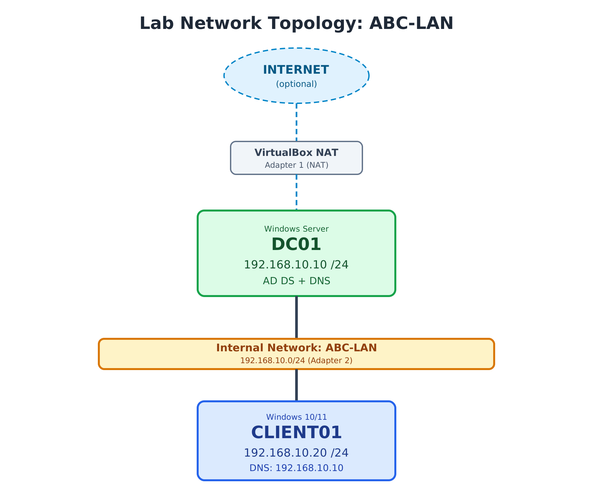

# 01 - Lab Environment

This folder documents how I built the virtual network for my Active Directory practice lab: a Windows Server Domain Controller (**DC01**) and a Windows client (**CLIENT01**) connected through an isolated VirtualBox internal network.

## Network Topology

## Lab Summary

| Item | Details |
|------|---------|
| Hypervisor | Oracle VirtualBox |
| Internal network | `ABC-LAN` (192.168.10.0/24) |
| DC01 | Windows Server, 192.168.10.10, AD DS + DNS |
| CLIENT01 | Windows 10/11, 192.168.10.20, DNS: 192.168.10.10 |
| VM adapters | Adapter 1: NAT (internet), Adapter 2: Internal Network `ABC-LAN` |

## Contents

| File | Description |
|------|-------------|
| [virtualbox-setup.md](virtualbox-setup.md) | Configuring the VirtualBox NAT and internal network adapters on both VMs |
| [network-configuration.md](network-configuration.md) | Static IP and DNS settings for DC01 and CLIENT01, plus ping connectivity tests |

## What I Accomplished

- Configured two network adapters on each VM: NAT for internet access and an internal network for lab traffic.
- Placed both VMs on the same internal network (`ABC-LAN`).
- Assigned static IP addresses in the 192.168.10.0/24 range.
- Pointed the client's DNS to the Domain Controller, as required for domain join.
- Verified two-way connectivity with ping (0% packet loss in both directions).

## Skills Demonstrated

- Virtual network design in VirtualBox (NAT vs. internal networking)
- IPv4 addressing and static IP configuration in Windows
- DNS requirements for Active Directory environments
- Connectivity testing and basic troubleshooting with ping

## Next

Continue to [02-active-directory-setup](../02-active-directory-setup/) to install AD DS, promote DC01 to a domain controller, and join CLIENT01 to the domain.
