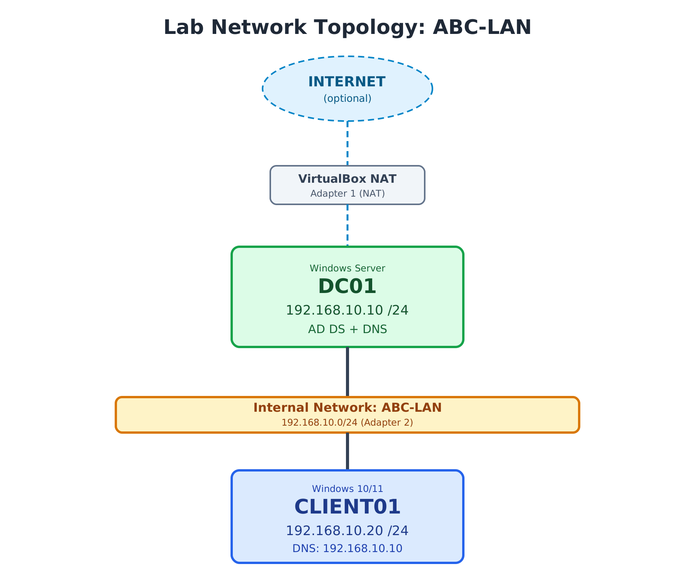

# Network Configuration

## Objective

Assign static IP addresses to **DC01** and **CLIENT01** on the `ABC-LAN` internal network, point the client to the Domain Controller for DNS, and verify connectivity with ping.

This follows [virtualbox-setup.md](virtualbox-setup.md), where the VirtualBox adapters were configured.

## Network Topology



## IP Addressing Plan

| Device | IP Address | Subnet Mask | Default Gateway | Preferred DNS |
|--------|------------|-------------|-----------------|---------------|
| DC01 | 192.168.10.10 | 255.255.255.0 (/24) | Not set (isolated lab) | 192.168.10.10 |
| CLIENT01 | 192.168.10.20 | 255.255.255.0 (/24) | Not set (isolated lab) | 192.168.10.10 |

### Why these settings?

- **Static IPs:** the Domain Controller's address must not change, because Active Directory and DNS depend on it.
- **Client DNS = DC01:** AD clients find the domain through DNS SRV records hosted on the DC. If the client uses a public DNS server instead, it cannot locate or join the domain.
- **No default gateway:** the `ABC-LAN` network is isolated, so there is no router to configure. Internet access, when needed, comes from the separate NAT adapter (Adapter 1).

## Steps

> **Which adapter?** Each VM has two adapters (see [virtualbox-setup.md](virtualbox-setup.md)). Set the static IP on the one attached to the internal network `ABC-LAN` (Adapter 2). Leave the NAT adapter (Adapter 1) on automatic.

### 1. Configure DC01

1. On DC01, open **Network Connections** by running `ncpa.cpl`.
2. Right-click the adapter connected to `ABC-LAN` and choose **Properties**.
3. Select **Internet Protocol Version 4 (TCP/IPv4)** and click **Properties**.
4. Choose **Use the following IP address** and enter:
   - IP address: `192.168.10.10`
   - Subnet mask: `255.255.255.0`
   - Default gateway: *(leave blank)*
5. Choose **Use the following DNS server addresses** and enter:
   - Preferred DNS server: `192.168.10.10`
6. Click **OK**.

### 2. Configure CLIENT01

1. On CLIENT01, open **Network Connections** by running `ncpa.cpl`.
2. Right-click the adapter connected to `ABC-LAN` and choose **Properties**.
3. Select **Internet Protocol Version 4 (TCP/IPv4)** and click **Properties**.
4. Choose **Use the following IP address** and enter:
   - IP address: `192.168.10.20`
   - Subnet mask: `255.255.255.0`
   - Default gateway: *(leave blank)*
5. Choose **Use the following DNS server addresses** and enter:
   - Preferred DNS server: `192.168.10.10`
6. Click **OK**.

### 3. Test connectivity

Open Command Prompt on each machine and ping the other.

**From CLIENT01 to DC01:**

```cmd
C:\Users\client>ping 192.168.10.10

Pinging 192.168.10.10 with 32 bytes of data:
Reply from 192.168.10.10: bytes=32 time<1ms TTL=128
Reply from 192.168.10.10: bytes=32 time<1ms TTL=128
Reply from 192.168.10.10: bytes=32 time<1ms TTL=128
Reply from 192.168.10.10: bytes=32 time<1ms TTL=128

Ping statistics for 192.168.10.10:
    Packets: Sent = 4, Received = 4, Lost = 0 (0% loss),
Approximate round trip times in milli-seconds:
    Minimum = 0ms, Maximum = 1ms, Average = 0ms
```

**From DC01 to CLIENT01:**

```cmd
C:\Users\Administrator>ping 192.168.10.20

Pinging 192.168.10.20 with 32 bytes of data:
Reply from 192.168.10.20: bytes=32 time<1ms TTL=128
Reply from 192.168.10.20: bytes=32 time=1ms TTL=128
Reply from 192.168.10.20: bytes=32 time=1ms TTL=128
Reply from 192.168.10.20: bytes=32 time=1ms TTL=128

Ping statistics for 192.168.10.20:
    Packets: Sent = 4, Received = 4, Lost = 0 (0% loss),
Approximate round trip times in milli-seconds:
    Minimum = 0ms, Maximum = 1ms, Average = 0ms
```

## Results

| Test | Source | Destination | Result |
|------|--------|-------------|--------|
| Ping | CLIENT01 | 192.168.10.10 (DC01) | 4 sent, 4 received, 0% loss |
| Ping | DC01 | 192.168.10.20 (CLIENT01) | 4 sent, 4 received, 0% loss |

Both machines reach each other over `ABC-LAN` with no packet loss and response times under 1 ms. A TTL of 128 is the default for Windows hosts, which confirms the replies came from the Windows VMs.

## Troubleshooting Notes

- **Ping times out:**
  - Confirm both VMs use the same internal network name (`ABC-LAN`) in VirtualBox.
  - Confirm the static IP was set on the adapter attached to `ABC-LAN`, not the NAT adapter.
  - Check that the Windows Firewall allows ICMPv4 echo requests (File and Printer Sharing, Echo Request - ICMPv4-In).
- **Wrong adapter configured:** run `ipconfig /all` to see which adapter holds which address.
- **Client cannot find the domain later:** make sure its DNS points to `192.168.10.10` and not a public DNS server.

## Key Takeaways

- Static IP addressing keeps the Domain Controller reachable at a fixed address.
- Clients in an AD environment must use the DC as their DNS server.
- Ping tests in both directions confirm basic Layer 3 connectivity before installing AD DS.

## Next Steps

Continue to [02-active-directory-setup](../02-active-directory-setup/), starting with the AD DS role installation and domain controller promotion.
