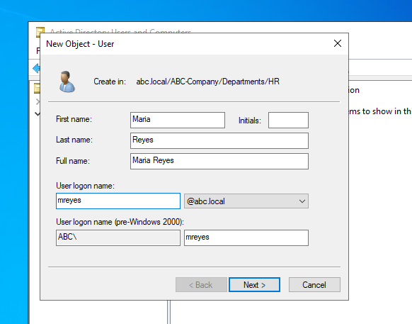
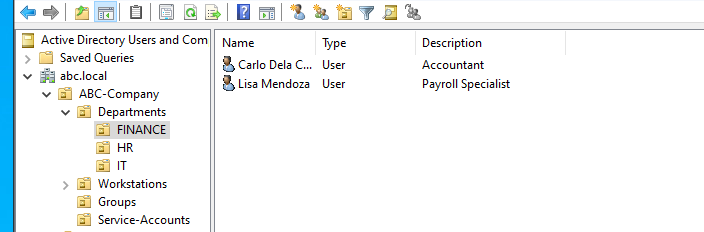

# User Creation

## Objective

Create the six company employee accounts in the `abc.local` domain, place each one in the correct department OU, set a temporary password that must be changed at first logon, and add a job description to each account.

## Prerequisites

- OU structure from [organizational-units.md](organizational-units.md) is in place
- Logged in to DC01 as a Domain Admin
- Tool: **Active Directory Users and Computers** (ADUC)

## Employee List

| Employee | Username | Department OU | Description |
|----------|----------|---------------|-------------|
| John Santos | jsantos | IT | IT Support Technician |
| Maria Reyes | mreyes | HR | HR Officer |
| Carlo Dela Cruz | cdelacruz | Finance | Accountant |
| Ana Garcia | agarcia | IT | Systems Administrator |
| Mark Villanueva | mvillanueva | HR | Recruitment Specialist |
| Lisa Mendoza | lmendoza | Finance | Payroll Specialist |

## Account Requirements

- Username (logon name) matches the list exactly
- Account placed in `OU=<Department>,OU=Departments,OU=ABC-Company,DC=abc,DC=local`
- Temporary password set
- **User must change password at next logon** enabled
- Description filled in
- Account enabled

## Steps

### 1. Open ADUC and go to the department OU

1. On DC01, open **Server Manager > Tools > Active Directory Users and Computers**.
2. Expand `abc.local` > `ABC-Company` > `Departments`.
3. Select the OU the user belongs to (for example, `IT`).

### 2. Create the user

1. Right-click the department OU > **New** > **User**.
2. Fill in the first name, last name, and full name, for example:
   - First name: `John`
   - Last name: `Santos`
   - User logon name: `jsantos`
3. Click **Next**.
4. Enter the temporary password and confirm it.
5. Check **User must change password at next logon**.
6. Make sure **Account is disabled** is **not** checked.
7. Click **Next**, then **Finish**.

### 3. Add the description

1. Double-click the new user.
2. On the **General** tab, enter the job title in the **Description** field (for example, `IT Support Technician`).
3. Click **OK**.




### 4. Repeat for the remaining users

Repeat steps 1 to 3 for each employee in the table, using the correct department OU.

> Use a temporary password that meets the domain's complexity requirements, and do not commit the real password to GitHub.

### 5. Verify




In ADUC, confirm each user appears in the correct OU and none has a down-arrow icon on the account (which would mean disabled).


## Troubleshooting Challenge: What if John Santos Was Created in the HR OU by Mistake?

**Would he still be able to log in to the domain?**
Yes. Authentication does not depend on which OU the account sits in. As long as the account is enabled and the password is correct, John can log in to any domain-joined computer. The OU only affects management, not whether login works.

**Would he receive HR policies?**
Yes. Group Policy applies to a user based on the OU where the user object lives. Any GPO linked to the HR OU (or to a parent such as `Departments` or `ABC-Company`) would apply to him, and he would miss the policies linked to the IT OU. Any admin permissions delegated on the HR OU would also cover his account.

**Why it matters:** the wrong OU can quietly give a user the wrong restrictions, drive mappings, or settings, and can put his account under the wrong administrators. Group membership is not affected, because security groups are separate from OU location.

**How to fix it:**
1. In ADUC, right-click John Santos > **Move** and choose `OU=IT`, or drag and drop the account.
2. Or use PowerShell:
   ```powershell
   Get-ADUser jsantos | Move-ADObject -TargetPath "OU=IT,OU=Departments,OU=ABC-Company,DC=abc,DC=local"
   ```
3. Run `gpupdate /force` on his computer, or have him log off and on again, so the correct policies apply.

## Key Takeaways

- Users are created inside the department OU so that policies and delegation apply correctly.
- The temporary password and forced change at next logon keep the admin from knowing the user's real password.
- OU placement controls policy and administration, not whether login works.

## Next Steps

Create security groups in the `Groups` OU and add the users to them (see `security-groups.md`).
