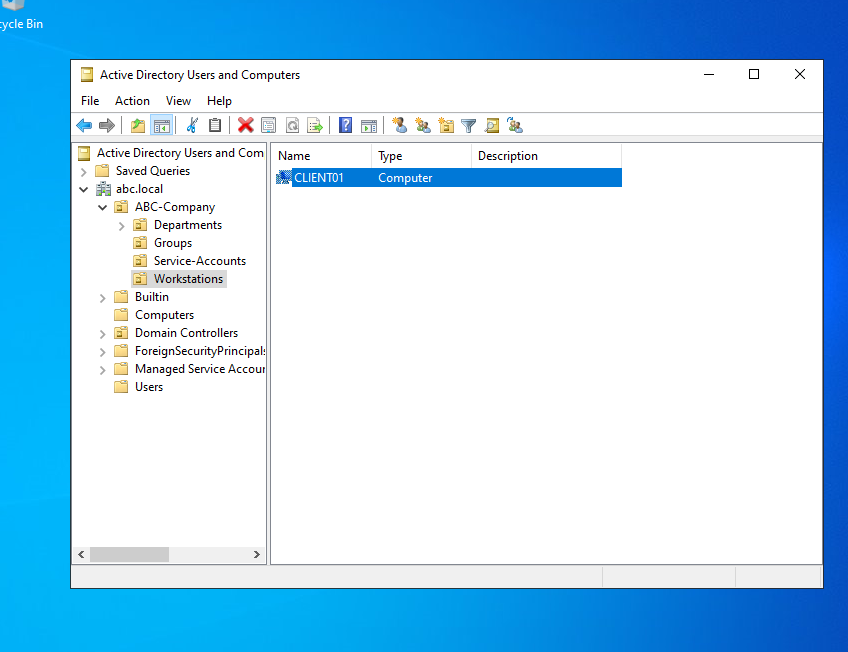

# Join the Client Computer to the Domain

## Objective

Rename the new workstation to `CLIENT01`, point it to DC01 for DNS, join it to the `abc.local` domain, log in with an employee account, and move its computer account into the `Workstations` OU.

## Environment

| Item | Details |
|------|---------|
| Client | CLIENT01 (Windows 10/11), 192.168.10.20/24 |
| Domain Controller | DC01, 192.168.10.10 (AD DS + DNS) |
| Domain | `abc.local` |
| Network | Internal network `ABC-LAN` |
| Target OU for the computer | `OU=Workstations,OU=ABC-Company,DC=abc,DC=local` |

## Steps

### 1. Rename the computer to CLIENT01

1. On the client, press `Win + R`, type `sysdm.cpl`, and press Enter.
2. On the **Computer Name** tab, click **Change**.
3. Enter `CLIENT01` as the computer name and click **OK**.
4. Restart if prompted (you can also restart once after the domain join).

PowerShell alternative:

```powershell
Rename-Computer -NewName "CLIENT01" -Restart
```

### 2. Configure the correct DNS server

The client must use the Domain Controller for DNS, because it finds the domain through DNS records hosted on DC01.

1. Run `ncpa.cpl` and open the properties of the adapter connected to `ABC-LAN`.
2. Open **Internet Protocol Version 4 (TCP/IPv4)** > **Properties**.
3. Confirm:
   - IP address: `192.168.10.20`
   - Subnet mask: `255.255.255.0`
   - Preferred DNS server: `192.168.10.10`

See [network-configuration.md](../01-lab-environment/network-configuration.md) for the full network setup.

### 3. Verify connectivity to DC01

```cmd
ping 192.168.10.10
nslookup abc.local
```

Both should succeed before attempting the join. A ping success only proves network reachability, while `nslookup` proves that DNS can find the domain.

### 4. Join the computer to the domain

1. Open `sysdm.cpl` > **Computer Name** tab > **Change**.
2. Under **Member of**, select **Domain** and enter `abc.local`.
3. Click **OK**.
4. When prompted for credentials, enter a domain account that is allowed to join computers (for example, the domain Administrator).
5. A "Welcome to the abc.local domain" message confirms the join.




PowerShell alternative:

```powershell
Add-Computer -DomainName "abc.local" -Credential (Get-Credential) -Restart
```

### 5. Restart the client

Restart the computer to finish joining the domain.

### 6. Log in using an employee account

1. On the login screen, choose **Other user**.
2. Sign in with a domain account, for example `ABC\jsantos` (or `jsantos@abc.local`), and the temporary password.
3. Because the account is set to **User must change password at next logon**, Windows will prompt for a new password. Set one that meets the domain's complexity rules.

### 7. Move the computer account to the Workstations OU

After the join, the computer account is created in the default `Computers` container. Move it to the correct OU.

1. On DC01, open **Active Directory Users and Computers**.
2. Expand `abc.local` > **Computers** and find `CLIENT01`.
3. Right-click `CLIENT01` > **Move** and select `ABC-Company` > `Workstations`.

PowerShell alternative:

```powershell
Get-ADComputer CLIENT01 | Move-ADObject -TargetPath "OU=Workstations,OU=ABC-Company,DC=abc,DC=local"
```

Verify the move:

```powershell
Get-ADComputer CLIENT01 | Select-Object Name, DistinguishedName
```

Expected distinguished name: `CN=CLIENT01,OU=Workstations,OU=ABC-Company,DC=abc,DC=local`

**Why move it?** The default `Computers` container is not an OU, so Group Policy cannot be linked to it. Placing the computer in the `Workstations` OU lets computer-based policies apply to it and keeps computers separate from users.

## Verification

Run these on CLIENT01 after logging in with the employee account.

| Command | What to check |
|---------|---------------|
| `ipconfig /all` | Host name is `CLIENT01`, IPv4 address is `192.168.10.20`, and DNS server is `192.168.10.10`. The primary DNS suffix should be `abc.local`. |
| `ping 192.168.10.10` | Replies from DC01 with 0% packet loss. |
| `nslookup abc.local` | Resolves the domain through DNS server `192.168.10.10`. |
| `whoami` | Returns the domain account, for example `abc\jsantos`, not a local account. |
| `systeminfo` | `Host Name` is `CLIENT01`, `Domain` is `abc.local`, and `Logon Server` is `\\DC01`. |

To filter the `systeminfo` output:

```cmd
systeminfo | findstr /B /C:"Host Name" /C:"Domain" /C:"Logon Server"
```

## Challenge: The Client Can Ping the Server but Cannot Join the Domain

Ping only proves that the two machines can reach each other at the network layer. Joining a domain needs more than that. These are the first three things I would check:

1. **DNS settings.** This is the most common cause. The client's DNS server must be the Domain Controller (`192.168.10.10`), not a router or a public DNS server such as 8.8.8.8. If the client has a second adapter (such as NAT), make sure that adapter isn't supplying a different DNS server first. Test with `nslookup abc.local`, and check the DC's service records with:
   ```cmd
   nslookup -type=SRV _ldap._tcp.dc._msdcs.abc.local
   ```
   If the domain doesn't resolve, the client can't find the domain controller.

2. **Time synchronization.** Kerberos authentication fails if the client's clock differs from the DC's by more than 5 minutes. Check the date, time, and time zone on both machines and correct them if needed.

3. **Credentials and permissions.** The account used must be valid, spelled correctly (for example, `ABC\Administrator`), and allowed to add computers to the domain. A wrong password, a disabled account, or an account without rights will block the join.

Other things worth checking if those three look fine:
- **Firewall or blocked ports:** ICMP can be allowed while the ports used by AD (such as DNS 53, Kerberos 88, LDAP 389, and SMB 445) are blocked.
- **Computer name conflicts:** a duplicate name or a stale computer account for `CLIENT01` already in AD.
- **DC services:** make sure the DNS Server and Netlogon services are running on DC01.

## Key Takeaways

- A computer account is created when a machine joins a domain, and it should be moved from `Computers` into the `Workstations` OU.
- DNS pointing at the Domain Controller is the most important requirement for a domain join.
- A successful ping does not guarantee that the domain join will work.
- Logging in with a domain account and checking `whoami` and `systeminfo` confirms the join worked.

## Next Steps

Continue to [03-user-management](../03-user-management/) to create security groups and manage access.
