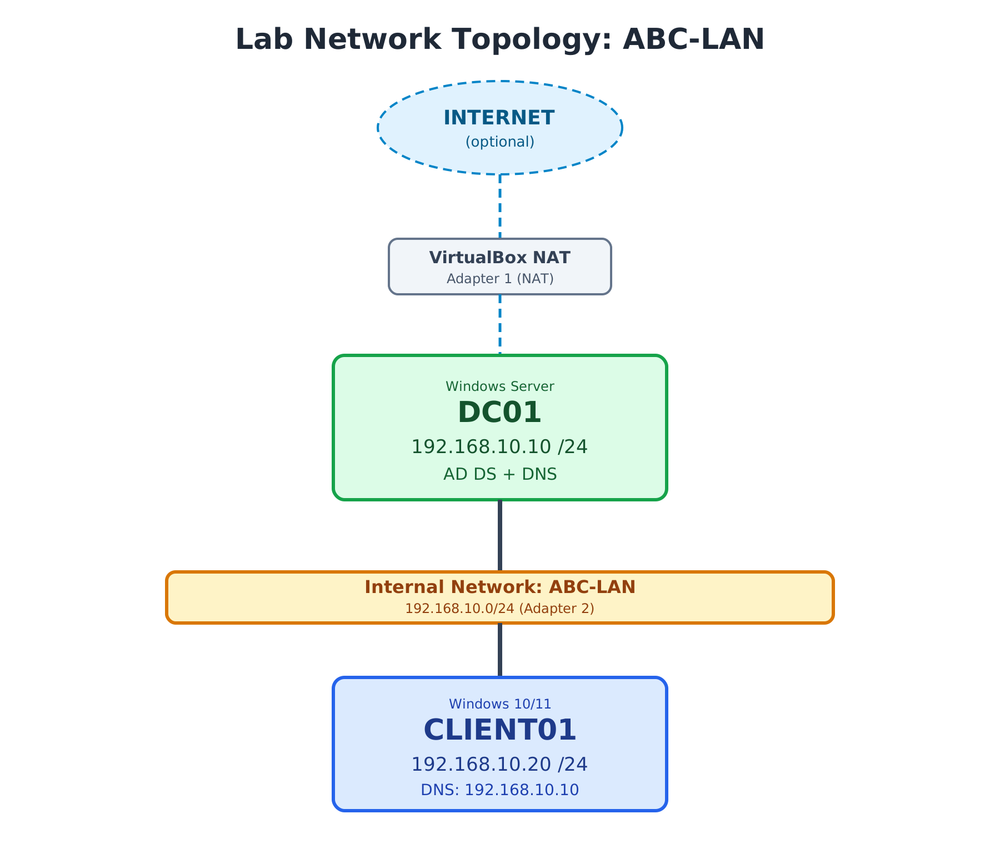

# VirtualBox Setup

## Objective

Prepare the VirtualBox virtual network so the Domain Controller (**DC01**) and the client (**CLIENT01**) can communicate in an isolated lab, with optional internet access.

## Network Topology

## Virtual Machines

| VM | Role | Operating System |
|----|------|------------------|
| DC01 | Domain Controller (AD DS + DNS) | Windows Server |
| CLIENT01 | Domain client | Windows 11 |

Both VMs were already created in VirtualBox before this step.

## Network Design

| Adapter | Type | Purpose | Used by |
|---------|------|---------|---------|
| Adapter 1(optional) | NAT | Internet access (updates, downloads) | DC01, CLIENT01 |
| Adapter 2 | Internal Network (`ABC-LAN`) | Private communication between DC01 and CLIENT01 | DC01, CLIENT01 |

### Why an Internal Network?

- It isolates the lab traffic from the host machine and the home network.
- VMs on the same internal network name can reach each other, and nothing else can reach them.
- It mimics a real isolated office LAN, which is ideal for practicing Active Directory.

> **Important:** Both VMs must use the **exact same** internal network name (`ABC-LAN`). A typo or different capitalization creates two separate networks and the VMs will not see each other.

## Steps

### 1. Power off both VMs

Network adapter settings can only be changed while the VM is powered off.

### 2. Configure Adapter 1 (Internal Network) on DC01

1. In VirtualBox, select **DC01** > **Settings** > **Network**.
2. Open the **Adapter 2* tab and check **Enable Network Adapter**.
3. Set **Attached to** to **Internal Network**.
4. Set **Name** to `ABC-LAN`.
5. Click **OK**.

### 3. Configure Adapter 1 (Internal Network) on CLIENT01

1. Select **CLIENT01** > **Settings** > **Network**.
2. Open the **Adapter 2** tab and check **Enable Network Adapter**.
3. Set **Attached to** to **Internal Network**.
4. Set **Name** to `ABC-LAN` (same as DC01).
5. Click **OK**.

### 4. (Optional) Add Adapter 1 (NAT) for internet access

Only needed if a VM requires internet access.

1. Select the VM > **Settings** > **Network**.
2. Open the **Adapter 1** tab and check **Enable Network Adapter**.
3. Set **Attached to** to **NAT**.
4. Click **OK**.

Keep Adapter 2 on `ABC-LAN`. The NAT adapter only provides internet, while all DC01 and CLIENT01 traffic stays on the internal network.

### 5. Start both VMs

Power on DC01 first, then CLIENT01. IP addressing is configured next in [network-configuration.md](network-configuration.md).

## Verification

Connectivity between the VMs is tested after IP configuration. See the ping results in [network-configuration.md](network-configuration.md).

## Key Takeaways

- Internal Network mode gives a safe, isolated lab network.
- Both VMs must share the exact same network name.
- A second NAT adapter can provide internet access without affecting the internal lab traffic.
